<div align="center">



<a href="https://github.com/RayVazcari"></a>
<a href="https://www.linkedin.com/in/rayvazcari/"></a>


</div>

# SOMOS.tech — Career Journey (concept prototype)

> **Porting this into the SOMOS.tech site?** Start with [`HANDOFF.md`](HANDOFF.md) (what's real vs. mocked and the rules to keep)
> and [`CLAUDE.md`](CLAUDE.md) (instructions for AI assistants). Prove the port with [`checks/tests.html`](checks/tests.html),
> [`checks/audit.js`](checks/audit.js) and the reference screens in [`docs/screens/`](docs/screens/).

A clickable, front-end-only mockup of the Career Journey: the successor to "Starting in Tech".
Plain HTML / CSS / JS (GSAP from a CDN). No build step, no backend.

**Start at `index.html`.** The first time you open it you choose one of two modes:

| Mode | What it is |
|---|---|
| **Example journey** | Alex Rivera, partway through (38% overall). Everything is pre-filled so you can see what the journey looks like with some history. |
| **Live demo** | Starts at 0%. Every real action moves the numbers: answer Discovery, pick and confirm a goal, check off items, build a resume. Your resume and LinkedIn draft are built from *your* answers. |

Switch or restart any time from the chip at the top right. Progress lasts until the browser tab closes.

## How the numbers work

One engine (`js/state.js`) owns all data; every page reads from it, so numbers can't disagree.

- AI Discovery: answered questions / 5
- Compare: decisions made / 2 · Goal: 100% once you confirm a primary path
- Learn / Build / Connect: items checked / items in that track
- **My Career Journey** = average of Learn, Build, Connect
- Prepare / Practice / Apply: real actions (resume downloaded, question rehearsed, job board opened, …)
- **Overall program** = average of the 9 stages above

## Limits of this prototype

- **No AI.** Conversations and role reasoning are scripted; they use the answers you give but there is no model behind them.
- **Practice and Apply hand off** to SOMOS programs (Mock Interview, Resume Review) that aren't part of this site. Two badge criteria carry a clearly-labelled "Prototype: mark done" button for that reason.
- **No accounts or saving.** State lives in `sessionStorage` only.
- The surrounding SOMOS.tech navigation (Home, Community, …) is a placeholder.
- Job-board links open each board's public search for the chosen role.

## Files

```
index.html …… the Map          ai-discovery.html · compare-careers.html · career-journey.html
living-roadmap.html · prepare.html · practice.html · apply.html
js/state.js (engine)  js/shell.js (progress card, journey strip, mode chip)  js/*.js (per page)
css/styles.css (tokens + Map)  css/shell.css  css/polish.css  css/<page>.css
```

Design notes: palette is navy / teal / gold; display face is Bricolage Grotesque (Google Fonts) with
system-ui for body text; all motion respects `prefers-reduced-motion`.
